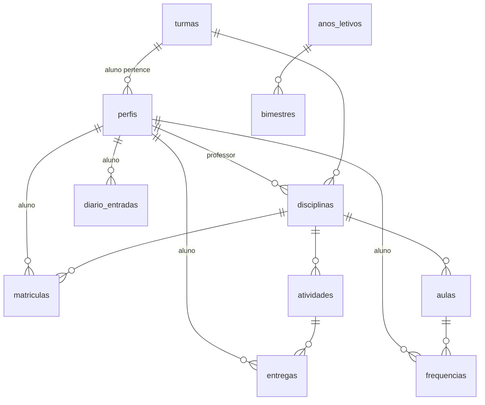

# Inventário e especificação da migração para o Supabase

Fase 1 do plano em `PROMPT_MIGRACAO_SUPABASE.md`. Este documento descreve o que o
app faz hoje com o Firestore e o Cloudinary e propõe o esquema, as regras e a
matriz de permissões do Supabase. **Nenhum código é escrito antes da aprovação.**

As referências `Arquivo.java:linha` apontam para
`app/src/main/java/br/com/example/meufuturoagora/`.

Decisões já tomadas (Seção 3.0 do plano) não são repetidas aqui como dúvida. As
perguntas novas estão na **Seção 7**.

---

## 1. Coleções do Firestore

Convenção: **L** = lê, **E** = escreve (cria/atualiza), **X** = apaga.

### 1.1 `alunos`

Dois tipos de documento convivem na mesma coleção:
- **cadastro** criado pelo admin, com ID aleatório (`CadastrarUsuarioActivity.java:233`);
- **conta** criada no primeiro login, com ID = uid do Firebase (`TelaEntrar.java:353`).
  No login a conta absorve o cadastro e o cadastro é apagado (`TelaEntrar.java:384`).

| Campo | Tipo | Observação |
|---|---|---|
| `nome` | string | Admin grava; no login é **sobrescrito** pelo nome da conta Google (`TelaEntrar.java:356`) |
| `email` | string | Chave de vinculação |
| `ativo` | bool | Sem `ativo` o login é recusado (`TelaEntrar.java:322`) |
| `turmaId`, `turmaNome` | string | Cópia do nome da turma |
| `pontuacao` | long | Gravada pelo **cliente** (`PontuacaoUtil.java:105`). Só existe em contas, não em cadastros |
| `fotoUrl`, `fotoPersonalizada` | string, bool | Foto do Google ou do Cloudinary (`PerfilFotoUtil.java:205`) |
| `admin` | bool | `AdminUtil.java:17`, também pode estar em `professores` |

Consultas: por `email` (login, admin, exclusão), por `turmaId` (ranking, notificações,
exclusão de turma), por ID em lotes de 10 com `whereIn` (fotos, nomes).
Escrevem: `CadastrarUsuarioActivity`, `TelaEntrar`, `PontuacaoUtil`, `PerfilFotoUtil`,
`ListaUsuariosActivity` (X). Leem: quase todas as telas.

### 1.2 `professores`

| Campo | Tipo | Observação |
|---|---|---|
| `nome`, `email`, `ativo` | | Gravados pelo admin (`CadastrarUsuarioActivity.java:202`) |
| `uid` | string | uid da conta, gravado no login (`TelaEntrar.java:282`) |
| `fotoUrl`, `fotoPersonalizada`, `admin` | | Como em `alunos` |

O documento do professor é **encontrado pelo e-mail**, não pelo uid
(`PerfilFotoUtil.java:48`, `InfoDisciplinaDialog.java:111`).

### 1.3 `turmas`

`nome`, `ano` (série, número), `ativo`. Identificada pelo nome sem diferenciar
maiúsculas (`CadastrarUsuarioActivity.java:171`). Excluir a turma remove
`turmaId`/`turmaNome` dos alunos e disciplinas dela (`ListaUsuariosActivity.java:314`).

### 1.4 `disciplinas`

`nome`, `turmaId`, `turmaNome`, `professorId`, `professorNome`, `professorEmail`,
`ativo`, `criadoEm`, `anoLetivo`, `bimestre`.
- **Criada pelo próprio professor** (`CriarDisciplinaActivity.java:125`, aberta por
  `TelaDisciplinaProfessor`), não pelo admin.
- Professor renomeia (`TelaDisciplinaProfessor.java:678`) e exclui de forma
  lógica, com `ativo = false` (`TelaDisciplinaProfessor.java:730`).
- `DisciplinaUtil.vincularAoProfessor` (`DisciplinaUtil.java:127`) reescreve
  `professorId` quando o uid do professor muda.

### 1.5 `matriculas`

ID composto `disciplinaId_alunoId`. Campos: `disciplinaId`, `disciplinaNome`,
`alunoId`, `alunoNome`, `turmaId`, `turmaNome` (cópias).
- Criadas **só no login do aluno**, para as disciplinas ativas da turma naquele
  momento (`TelaEntrar.java:408`). Uma disciplina criada depois só entra no
  próximo login.
- Apagadas na exclusão do aluno (`ListaUsuariosActivity.java:265`) e como
  "órfãs" pelo próprio cliente (`DisciplinaUtil.java:52`, `ListaUsuariosActivity.java:282`).

### 1.6 `atividades` (chamadas de "trilhas" na interface)

`nome`, `descricao`, `pontos` (1 a 10, validado no cliente em `CriarAtividade.java:742`),
`prazo` (texto `dd/MM/yyyy`), `link`, `disciplinaId`, `professorId`, `ativo`,
`arquivoNome`, `arquivoUrl`, `criadoEm`, `anoLetivo`, `bimestre`.
- Exclusão **física** (`TelaDetalhesDisciplinaProfessor.java:576`). As entregas
  ficam órfãs e o arquivo continua no Cloudinary.

### 1.7 `entregas`

ID composto `atividadeId_alunoId` (`TelaAtividadeAluno.java:149`). Campos:
`atividadeId`, `alunoId`, `comentarioAluno`, `arquivoNome`, `arquivoUrl`,
`avaliado`, `enviadoEm`, `anoLetivo`, `bimestre`, e da avaliação: `nota` (double),
`comentarioProfessor`, `avaliadoEm`.
- Exige comentário **ou** arquivo (`TelaAtividadeAluno.java:288`).
- **Não pode ser alterada depois de enviada** (`TelaAtividadeAluno.java:309`, `:252`).
- **O prazo não é verificado em lugar nenhum**: o aluno consegue entregar depois do prazo.
- **A nota não tem limite**: só se confere se é um número (`AvaliarEntregaActivity.java:136`).
- "Refazer avaliação" apaga nota, comentário e `avaliadoEm` (`QuestoesDoLivroActivity.java:309`).

### 1.8 `aulas`

`quantidade`, `descricao`, `data` (texto), `disciplinaId`, `professorId`, `ativo`,
`anoLetivo`, `bimestre` (`CadastrarAulaActivity.java:117`). A exclusão é física,
pela lista de frequência (`RegistrarFrequenciaActivity`); ver a Seção 8.2.

### 1.9 `frequencias`

ID composto `aulaId_alunoId`. `aulaId`, `disciplinaId`, `alunoId`, `alunoNome`,
`status` (`Presente`, `Falta`, `Falta justificada`), `data`, `anoLetivo`, `bimestre`
(`FrequenciaAulaActivity.java:209`). Gravada aluno por aluno, sem lote.

### 1.10 `penalidades`

ID `alunoId_ddMMyyyy`. `alunoId`, `data`, `pontos` (-5), `criadoEm`, `anoLetivo`,
`bimestre`. É **derivada** da frequência: existe se o aluno tem ao menos uma
`Falta` sem justificativa no dia (`PenalidadeFaltaUtil.java:25`).

### 1.11 `configuracoes/geral`

`anoLetivo` (texto), `bimestre1Inicio` … `bimestre4Fim` (texto `dd/MM/yyyy`),
`pontuacaoZeradaEm` (legado, só lido em `PontuacaoUtil.java:216`).

### 1.12 `anosLetivos`

ID = ano. `ano`, `iniciadoEm`, `encerradoEm` e cópia das datas dos 4 bimestres
(`DefinirAnoLetivoActivity.java:158`, `DefinirBimestresActivity.java:130`).

### 1.13 `frequenciasArquivadas`

**Só é lida** (`DesempenhoActivity.java:265`, `:339`). Nenhum código grava nela. É
resto de uma versão anterior e não será migrada.

### 1.14 `diarios/{uid}/entradas`

`texto`, `criadoEm`, ordenado por `criadoEm` desc (`DiarioAlunoActivity.java:174`).
O aluno cria, edita e apaga as próprias entradas. Hoje usa `addSnapshotListener`
(será removido, decisão N2).

### 1.15 `administrador`

Senha em texto puro conferida no cliente (`DefinirAnoLetivoActivity.java:131`).
**Será eliminada** (decisão N5).

### 1.16 Fora do banco

- **Histórico de notificações** (`NotificacaoHistorico`): `SharedPreferences`, local.
- **Cursos do IF** (`CursosIfUtil`, `MeuFuturoActivity`): conteúdo fixo no código.
- **Cloudinary**: pastas `atividades/<disciplinaId>`, `entregas/<atividadeId>` e fotos
  de perfil. Qualquer tipo de arquivo (`launch("*/*")`, `CriarAtividade.java:176`,
  `TelaAtividadeAluno.java:127`), limite de 3 MB no cliente (`ArquivoUtil.java:11`).
  As fotos de perfil são recortadas e convertidas para JPEG de até 512 px
  (`PerfilFotoUtil.java:35`).

---

## 2. Telas

| Tela | Perfil | Lê | Grava |
|---|---|---|---|
| `Splash`, `TelaLogin1`, `MainActivity` | todos | sessão | — |
| `TelaEntrar` | todos | professores, alunos, disciplinas | professores, alunos, matriculas; X alunos |
| `TelaInicialAluno` | aluno | alunos, matriculas, disciplinas, frequencias, atividades, configuracoes | alunos.pontuacao (via `PontuacaoUtil`) |
| `TelaDisciplinaAluno`, `TelaDetalhesDisciplinaAluno` | aluno | matriculas, disciplinas, atividades, entregas | X matriculas órfãs |
| `TelaAtividadeAluno` | aluno | atividades, entregas | entregas, arquivo |
| `TelaPerfilAluno` | aluno | alunos, entregas, frequencias | foto |
| `DiarioAlunoActivity` | aluno | diário | diário |
| `TelaInicialProfessor` | professor | disciplinas | — |
| `TelaDisciplinaProfessor` | professor | disciplinas, matriculas, alunos | disciplinas (nome, ativo) |
| `CriarDisciplinaActivity` | professor | turmas | disciplinas |
| `TelaDetalhesDisciplinaProfessor` | professor | matriculas, alunos, disciplinas, atividades | X atividades |
| `CriarAtividade` | professor | disciplinas, atividades | atividades, arquivo |
| `QuestoesDoLivroActivity` | professor | atividades, matriculas, entregas, alunos | entregas (refazer avaliação) |
| `AvaliarEntregaActivity` | professor | entregas | entregas (nota) |
| `CadastrarAulaActivity` | professor | — | aulas |
| `RegistrarFrequenciaActivity`, `FrequenciaAulaActivity` | professor | aulas, frequencias, matriculas, alunos | frequencias, penalidades |
| `TelaPerfilProfessor` | professor | disciplinas, atividades, aulas | foto |
| `InfoDisciplinaDialog` | aluno, professor | disciplinas, professores, matriculas, alunos | — |
| `RankingActivity` | aluno, professor | turmas, alunos | alunos.pontuacao |
| `DesempenhoActivity` | aluno, professor | configuracoes, disciplinas, matriculas, frequencias, frequenciasArquivadas, entregas, atividades, aulas | — |
| `TelaAdminHome` | admin | configuracoes | — |
| `CadastrarUsuarioActivity` | admin | turmas, professores, alunos | turmas, professores, alunos |
| `ListaUsuariosActivity` | admin | professores, turmas, alunos, matriculas, disciplinas | X alunos, professores, turmas, matriculas |
| `DefinirAnoLetivoActivity` | admin | configuracoes, administrador | anosLetivos, configuracoes; recalcula todos |
| `DefinirBimestresActivity` | admin | configuracoes | configuracoes, anosLetivos; recalcula todos |
| `HistoricoAnoLetivoActivity` | admin | tudo (8 coleções inteiras) | — |
| `ConfiguracoesActivity` | todos | — | logout |
| `NotificacaoWorker` | aluno, professor | alunos, disciplinas, atividades, entregas | — |

Navegação: `TelaEntrar` leva a `TelaInicialAluno` ou `TelaInicialProfessor`. O botão
da área do admin aparece no perfil de quem tem `admin = true` (`AdminUtil.java:58`)
e abre `TelaAdminHome`. Alunos e professores navegam por uma barra inferior
(início, disciplinas, ranking, diário só para aluno, perfil).

---

## 3. Regras de negócio implícitas

1. **Acesso restrito.** Só entra quem foi cadastrado pelo admin e está ativo. O
   professor tem precedência: se o e-mail estiver nas duas coleções, entra como
   professor (`TelaEntrar.java:248`). Aluno sem turma não entra (`TelaEntrar.java:332`).
2. **Vinculação por e-mail.** O cadastro do admin vira a conta no primeiro login.
   Se o uid mudar (conta Google recriada), as disciplinas, trilhas e aulas são
   transferidas para o uid novo (`DisciplinaUtil.java:127`). Com uma tabela `perfis`
   de ID próprio, essa transferência deixa de ser necessária.
3. **Pontuação do ranking** (`PontuacaoUtil.java:21`): soma das notas das entregas
   avaliadas, contando só trilhas e disciplinas ativas e do ano letivo atual,
   **menos 5 pontos por dia** com ao menos uma falta sem justificativa. É sempre
   recalculada do zero, não somada aos poucos.
4. **Ano letivo de um registro.** Cada registro guarda `anoLetivo` e `bimestre` do
   momento em que foi criado (`AnoLetivoUtil.marcar`). O bimestre atual é aquele
   cujo intervalo contém a data de hoje, com o último dia valendo até 23:59:59
   (`BimestreUtil.java:51`). Registros sem `anoLetivo` contam se a data cair no
   período dos bimestres (regra de legado, dispensável porque não há dados a migrar).
5. **Troca de ano letivo** (`DefinirAnoLetivoActivity.java:156`): arquiva o ano
   anterior com as datas dos bimestres, cria o novo, limpa os bimestres e
   recalcula a pontuação de todos. Notas e faltas antigas continuam salvas para o
   histórico.
6. **Ranking por turma.** Ordenado por pontos e, no empate, por nome
   (`RankingActivity.java:459`). O aluno vê o pódio (3 primeiros) e a própria
   posição. Hoje o professor escolhe **qualquer turma** e vê todos os alunos. Na
   migração, ele passa a ver só as turmas em que tem disciplina (D2).
7. **Entrega única**: o aluno envia uma vez e não altera mais. Só o professor pode
   "refazer a avaliação".
8. **Exclusões**: aluno é apagado de verdade junto com as matrículas, mas entregas
   e frequências ficam; professor é apagado sem mexer nas disciplinas; turma é
   apagada e desvinculada; disciplina é desativada; trilha é apagada.

---

## 4. Esquema proposto

Os campos têm a mesma estrutura em alunos e professores. Por isso proponho uma
tabela única **`perfis`**, sem tabelas 1:1 separadas. Nomes em português e
`snake_case`.

### 4.1 Tabelas

Todas têm RLS habilitado, `criado_em timestamptz not null default now()` e, quando
editáveis, `atualizado_em` mantido por trigger.

**`perfis`**
| Coluna | Tipo | Regra |
|---|---|---|
| `id` | `uuid` PK | `default gen_random_uuid()`. Existe antes do primeiro login |
| `usuario_id` | `uuid` unique, null | FK `auth.users(id) on delete set null`. Preenchido por `vincular_conta()` |
| `email` | `citext` unique not null | |
| `nome` | `text` not null | |
| `tipo` | `text` not null | `check (tipo in ('aluno','professor'))` |
| `admin` | `boolean` not null default false | Só o admin altera |
| `ativo` | `boolean` not null default true | |
| `turma_id` | `uuid` null | FK `turmas on delete set null`. `check (tipo = 'aluno' or turma_id is null)` |
| `foto_google_url` | `text` null | URL pública da foto do Google, atualizada no login |
| `foto_path` | `text` null | Caminho no bucket `fotos-perfil` quando o usuário escolhe a própria |

`foto_personalizada` vira `foto_path is not null`. `pontuacao` **deixa de existir**
como coluna (ver 4.3). Se o mesmo e-mail precisar ser aluno e professor, a regra
atual (professor tem precedência) deixa de fazer sentido: um e-mail = um perfil.

**`turmas`**: `id`, `nome text not null`, `serie smallint` (o antigo `ano`), `ativo`.
Índice único em `lower(btrim(nome))`.

**`anos_letivos`**: `ano smallint` PK (`check` entre 2000 e 2100), `atual boolean
not null default false` com índice único parcial `where atual` (no máximo um ano
atual), `iniciado_em`, `encerrado_em`. Substitui `configuracoes/geral` e `anosLetivos`.

**`bimestres`**: `ano` FK `anos_letivos on delete cascade`, `numero smallint check
(numero between 1 and 4)`, `inicio date not null`, `fim date not null`,
`check (fim >= inicio)`, PK (`ano`, `numero`). Datas viram `date` em vez de texto.

**`disciplinas`**: `id`, `nome`, `turma_id` FK `turmas on delete set null`,
`professor_id` FK `perfis on delete restrict`, `ano_letivo` FK, `ativo`. Saem
`turmaNome`, `professorNome` e `professorEmail` (passam a vir por `JOIN`).

**`matriculas`**: PK (`disciplina_id`, `aluno_id`), ambos `on delete cascade`.
Saem todas as cópias de nome.

**`atividades`**: `id`, `disciplina_id` FK `on delete cascade`, `nome`, `descricao`,
`pontos smallint check (pontos between 1 and 10)`, `prazo date`, `link text`,
`arquivo_path`, `arquivo_nome`, `ano_letivo`, `bimestre smallint null`, `ativo`.
Sai `professorId` (o professor é o da disciplina).

**`entregas`**: `id`, `atividade_id` FK `on delete cascade`, `aluno_id` FK `perfis
on delete cascade`, unique (`atividade_id`, `aluno_id`), `comentario_aluno`,
`arquivo_path`, `arquivo_nome`, `enviado_em`, `nota numeric(4,2)`,
`comentario_professor`, `avaliado_em`, `ano_letivo`, `bimestre`.
`check (comentario_aluno <> '' or arquivo_path is not null)`.
`dias_atraso smallint not null default 0`, calculado pelo trigger no envio:
dias entre o `prazo` e a data de envio no fuso de Brasília, ou 0 se a entrega
estiver no prazo (decisão D4: a entrega atrasada é aceita e marcada).
`avaliado` vira `avaliado_em is not null`. O limite da nota depende da dúvida D3.

**`aulas`**: `id`, `disciplina_id` FK `on delete cascade`, `data date`,
`quantidade smallint check (quantidade > 0)`, `descricao`, `ano_letivo`, `bimestre`,
`ativo`. Sai `professorId`.

**`frequencias`**: PK (`aula_id`, `aluno_id`), `status text check (status in
('presente','falta','falta_justificada'))`. Saem `data`, `disciplinaId`,
`alunoNome`, `anoLetivo` e `bimestre`, que vêm da aula.

**`diario_entradas`**: `id`, `aluno_id` FK `perfis on delete cascade` com
`default` do perfil logado, `texto text not null`, `criado_em`, `atualizado_em`.
Índice em (`aluno_id`, `criado_em desc`).

**`solicitacoes_exclusao`** (decisão D12): `id`, `perfil_id` FK `perfis on delete
cascade`, `motivo text null`, `status text check (status in
('pendente','aprovada','recusada'))`, `decidido_por` FK `perfis on delete set null`,
`decidido_em`, `criado_em`. Índice único parcial em `perfil_id where status =
'pendente'`, para haver no máximo um pedido aberto por usuário. Quando o pedido é
aprovado, o usuário é excluído e a linha vai junto, mas fica um registro mínimo
em `exclusoes_realizadas` (data e quem decidiu, sem dados pessoais) como
comprovante do atendimento (LGPD).

**Eliminadas**: `administrador`, `configuracoes`, `penalidades`,
`frequenciasArquivadas`.

### 4.2 Ano letivo e bimestre preenchidos pelo servidor

Um trigger `before insert` em `disciplinas`, `atividades`, `entregas` e `aulas`
preenche `ano_letivo` com o ano atual e `bimestre` com o bimestre que contém a
data (hoje, ou a `data` da aula). O cliente não envia esses campos.

### 4.3 Pontuação, penalidades e ranking calculados no servidor

- **Penalidade** vira uma *view* interna `penalidades`: um registro por aluno e
  dia com ao menos uma frequência `falta`. Nada é gravado, então nada fica dessincronizado.
- **Pontuação** vira uma função `pontuacao_aluno(aluno_id, ano)` com a mesma regra
  de `PontuacaoUtil`. Ninguém, nem o admin, grava pontos.
- **Ranking**: função `ranking_turma(turma_id)` que devolve só `perfil_id`, `nome`,
  `foto`, `pontos` e `posicao`, com o empate decidido pelo nome. Para o aluno,
  devolve o pódio e a própria linha. Para o professor, a turma inteira.

Isso resolve o problema 5 da Seção 1.1 sem triggers de recálculo.

### 4.4 Índices

Toda FK ganha índice. Além delas: `perfis (turma_id) where tipo = 'aluno'`,
`disciplinas (professor_id) where ativo`, `disciplinas (turma_id) where ativo`,
`entregas (aluno_id) where avaliado_em is not null`, `frequencias (aluno_id)`,
`atividades (disciplina_id, criado_em)` (notificações).

### 4.5 Funções (RPC) e auxiliares

Auxiliares (`security definer`, `stable`, `set search_path = ''`, sem acesso para `anon`):
`perfil_atual()`, `eh_admin()`, `professor_da_disciplina(disciplina_id)`,
`aluno_matriculado(disciplina_id)`, `ano_letivo_atual()`.

| Função | Quem chama | Substitui |
|---|---|---|
| `vincular_conta()` | qualquer autenticado, no login | `TelaEntrar.verificarUsuario`, `DisciplinaUtil.vincularAoProfessor`. Usa o e-mail **verificado** do token, grava `usuario_id`, atualiza a foto do Google e devolve o perfil, ou erro "não autorizado" |
| `definir_ano_letivo(ano)` | admin | `DefinirAnoLetivoActivity.salvarAnoLetivo`, numa transação |
| `definir_bimestres(ano, datas jsonb)` | admin | `DefinirBimestresActivity.salvarBimestres`. Valida as datas: sem sobreposição e em ordem |
| `registrar_frequencia(aula_id, registros jsonb)` | professor da disciplina | O laço de `FrequenciaAulaActivity` e o `PenalidadeFaltaUtil` |
| `avaliar_entrega(entrega_id, nota, comentario)` | professor da disciplina | `AvaliarEntregaActivity` |
| `refazer_avaliacao(entrega_id)` | professor da disciplina | `QuestoesDoLivroActivity.refazerAvaliacao` |
| `excluir_usuario(perfil_id)` | admin | `ListaUsuariosActivity`. Exclusão definitiva de tudo do usuário, inclusive os arquivos no Storage e a conta em `auth.users` (D7). Recusa se for professor com disciplinas (D13) ou o último admin ativo (D14) |
| `transferir_disciplinas(de_professor, para_professor)` | admin | Novo (D13) |
| `solicitar_exclusao(motivo)` | aluno, professor | Novo (D12) |
| `decidir_exclusao(solicitacao_id, aprovar)` | admin | Novo (D12). Ao aprovar, chama `excluir_usuario` |
| `excluir_atividade(atividade_id)` | professor da disciplina, admin | `TelaDetalhesDisciplinaProfessor.excluirAtividade`. Apaga a trilha, as entregas e os arquivos (D6). A tela mostra antes quantas entregas serão apagadas |
| `ranking_turma(turma_id)` | aluno, professor | `RankingActivity`, `PontuacaoUtil` |
| `posicao_no_ranking()` | aluno | `RankingActivity.java:425` (tela inicial e perfil) |
| `desempenho(aluno_id)` | o aluno, o professor das disciplinas, admin | Cálculos de `DesempenhoActivity` |
| `historico_ano_letivo(ano)` | admin | As 8 leituras completas de `HistoricoAnoLetivoActivity` |
| `novidades_desde(desde timestamptz)` | aluno, professor | As consultas do `NotificacaoWorker` |

**Matrícula automática** por trigger, no lugar do laço em `TelaEntrar.java:408`:
quando uma disciplina é criada (ou muda de turma), os alunos ativos da turma são
matriculados; quando um aluno ganha ou troca de turma, é matriculado nas
disciplinas ativas dela (decisão D9).

### 4.6 Storage

Conforme a Seção 4.5 do plano: buckets privados `atividades`, `entregas` e
`fotos-perfil`, com 3 MB, caminhos com UUID e URL assinada de 10 minutos. Em
`atividades` e `entregas`, só PDF, JPEG, PNG e WEBP (D5). Para `fotos-perfil`, só `image/jpeg`,
porque o app já converte a foto (`PerfilFotoUtil.java:189`).

---

## 5. Matriz de permissões

Legenda: **T** = todas as linhas, **P** = só as próprias, **D** = só das suas
disciplinas, **M** = só das disciplinas em que está matriculado, **—** = nenhum
acesso. "RPC" = só por função, nunca por escrita direta na tabela. `anon` não tem
acesso a nada.

| Tabela | Operação | Aluno | Professor | Admin |
|---|---|---|---|---|
| `perfis` | select | P, mais nome e foto dos colegas via ranking/funções | P, mais os alunos matriculados (D) | T |
| | insert | — | — | T |
| | delete | — | — | RPC `excluir_usuario` |
| | update | P: só `foto_path` | P: só `foto_path` | T |
| `turmas` | select | a própria | as das suas disciplinas, mais a lista de turmas ativas para criar disciplina | T |
| | insert / update / delete | — | — | T |
| `anos_letivos`, `bimestres` | select | T | T | T |
| | escrita | — | — | RPC |
| `disciplinas` | select | M | D | T |
| | insert / update | — | D | T |
| | delete | — | — (desativa com `ativo = false`) | T |
| `matriculas` | select | P | D | T |
| | escrita | — (trigger) | — (trigger) | T |
| `atividades` | select | M, só ativas | D | T |
| | insert / update / delete | — | D | T |
| `entregas` | select | P | D | T |
| | insert | P, em atividade M (D4) | — | — |
| | update | — (imutável depois de enviada) | RPC (avaliar / refazer) | RPC |
| | delete | — | — | — |
| `aulas` | select | M | D | T |
| | insert / update | — | D | T |
| `frequencias` | select | P | D | T |
| | escrita | — | RPC | RPC |
| `diario_entradas` | select / insert / update / delete | P | — | — (D8) |
| `solicitacoes_exclusao` | select | P | P | T |
| | insert | RPC | RPC | — |
| | update | — | — | RPC `decidir_exclusao` |
| Storage `atividades` | leitura | M | D | T |
| | escrita | — | D | — |
| Storage `entregas` | leitura | P | D | T |
| | escrita | P, só na criação | — | — |
| Storage `fotos-perfil` | leitura | qualquer autenticado (N6) | idem | idem |
| | escrita | P | P | P |

Regras gerais: usuário com `ativo = false` ou sem `usuario_id` vinculado não passa
em nenhuma política. Um admin que também é aluno ou professor tem as duas
permissões somadas.

---

## 6. Ordem dos módulos (Fases 4 e 5)

A Fase 4 cria a base comum (`SupabaseCliente`, sessão, `ErroApi`, `Servicos`) e
os repositórios. A Fase 5 migra as telas nesta ordem, igual à do plano:

1. **Login e sessão**: dependem de `perfis` e `vincular_conta()`. Todos os outros módulos dependem deste.
2. **Perfis e admin**: cadastros, lista de usuários e fotos. Depende de 1, e o upload de foto usa o repositório de arquivos de 5.
3. **Estrutura escolar**: anos letivos, bimestres, turmas, disciplinas e matrículas. Depende de 2.
4. **Aulas e frequência**: depende de 3.
5. **Atividades, entregas e arquivos**: depende de 3. Aqui o upload volta a funcionar.
6. **Diário**: só depende de 1. Pode ser feito antes, se quiser um módulo simples para validar a base.
7. **Desempenho e ranking**: depende de 4 e 5.
8. **Notificações**: depende de 3 e 5.
9. **Demais telas**: as telas iniciais e de disciplina, que juntam vários módulos.

Sugestão: a foto de perfil do módulo 2 fica para o fim do módulo 5, quando o
repositório de arquivos existir. Até lá aparece só a foto do Google.

---

## 7. Dúvidas para o usuário

### 7.1 Decididas pelo usuário

| # | Decisão |
|---|---|
| D1 | O professor continua criando, renomeando e desativando as **próprias** disciplinas. O admin gerencia todas |
| D2 | O professor vê o ranking **só das turmas em que dá aula** |
| D4 | Entrega depois do prazo é **aceita e marcada como atrasada**, com a quantidade de dias de atraso visível para o aluno e para o professor |
| D7 | Só o **admin** exclui aluno ou professor, e a exclusão **apaga tudo de vez** |
| D3 | A nota vai de **0 até os `pontos` da trilha**, validada no servidor |
| D5 | Trilhas e entregas aceitam só **PDF e imagens** (`application/pdf`, `image/jpeg`, `image/png`, `image/webp`). O seletor do app também passa a filtrar esses tipos |
| D6 | Excluir uma trilha apaga as entregas e os arquivos dela, depois de um **aviso de confirmação** que informa quantas entregas serão apagadas |
| D8 | O diário só é visto pelo **próprio aluno**. Nem professor nem admin leem |
| D10 | Cada e-mail tem **um único perfil**. O cadastro avisa se o e-mail já existe |
| D11 | **Só professores** podem ser admin: `check (not admin or tipo = 'professor')` |
| D12 | O usuário pede a exclusão **dentro do app**, por um botão "Solicitar exclusão dos meus dados" no perfil. O pedido vai para o admin, que **aprova ou recusa**. Ao aprovar, roda a exclusão definitiva (D7) |
| D13 | Antes de excluir um professor, as disciplinas dele **precisam ser transferidas** para outro professor. A exclusão é bloqueada enquanto houver disciplina sem transferir |
| D14 | Não é possível excluir nem desativar o **último admin ativo** |
| D9 | **Matrícula automática** por trigger: ao criar uma disciplina (ou mudá-la de turma), os alunos ativos da turma são matriculados na hora; ao cadastrar um aluno ou mudá-lo de turma, ele é matriculado nas disciplinas ativas dela |
| D15 | **O app aceita apenas login com Google.** O provedor de e-mail e senha fica desligado em todo projeto Supabase (desenvolvimento e produção). Ver a Seção 8.3 |

Todas as dúvidas foram respondidas. **Portão 1 aprovado em 29/10/2026.**

---

## 8. Ajustes feitos na Fase 3

O que mudou em relação às Seções 4 e 5 durante a implementação das migrações,
e por quê. Nenhum ajuste muda uma decisão da Seção 7.

| Item | Previsto | Implementado | Motivo |
|---|---|---|---|
| `desempenho(aluno_id)` e `historico_ano_letivo(ano)` | RPCs | Leitura direta das tabelas, mais a RPC `pontuacao(aluno, ano)` | O RLS já entrega a cada perfil exatamente o que ele pode ver; menos código no servidor |
| `excluir_atividade(id)` | RPC | `delete` direto em `atividades`, com cascata nas entregas | O Storage não deixa apagar arquivos por SQL (`storage.protect_delete`). O app apaga os arquivos pela API do Storage e depois a linha |
| Arquivos na exclusão de usuário | Dentro de `excluir_usuario` | O app apaga os arquivos antes de chamar a RPC | Mesmo motivo |
| `atividades.ativo` e `aulas.ativo` | Colunas | Removidas | Nada desativa trilhas (D6 apaga) nem aulas |
| Escrita em `matriculas` pelo admin, `delete` em `disciplinas` | Permitidos | Sem acesso pela API | As matrículas são só dos gatilhos (D9); a disciplina é desativada |
| E-mail trocado pelo admin | Não previsto | A conta ligada ao e-mail antigo perde o acesso na hora | Sem isso, a conta antiga continuaria acessando os dados do perfil |
| Nome no login | Hoje é sobrescrito pelo nome do Google | Fica o nome cadastrado pelo admin | O nome do Google é editável pelo usuário e aparece no ranking |
| Foto do Google | Qualquer URL | Só URLs `*.googleusercontent.com` | O metadado é editável pelo usuário |
| Bimestre da aula | Bimestre de hoje (como `AnoLetivoUtil.marcar`) | Bimestre da data da aula | A frequência costuma ser lançada depois da aula |
| Ranking: seletor de turmas | Não previsto | RPC `turmas_do_ranking()` | Professor não lê a tabela de turmas filtrada por D2 |
| Funções auxiliares | `public` | Esquema `privado`, fora da Data API | Não ficam chamáveis como RPC |

### 8.1 Avisos aceitos do Security Advisor (projeto remoto)

O advisor do projeto remoto, que é mais novo que o da CLI local, aponta
`authenticated_security_definer_function_executable` (lint 0029) para as 20
RPCs de `public`. É intencional: essas funções são a API do app e precisam ser
`security definer` para gravar em tabelas que o usuário não grava direto
(notas, frequência, ano letivo, exclusões). Cada uma confere no início quem
está chamando, e os testes pgTAP cobrem a recusa (42501) de cada uma.
Nenhum outro aviso de segurança ou desempenho apareceu.

O histórico do admin (migração `20261030001031`) acrescentou 4 funções ao
mesmo aviso: `historico_anos`, `historico_alunos`, `historico_trilhas` e
`historico_entregas`. Todas chamam `privado.exigir_admin()` na primeira linha, e
o pgTAP `110_historico` confere a recusa de professor, aluno e anônimo.

### 8.2 Correção: excluir aula existe

A Seção 1.8 dizia "Não há tela de excluir aula", mas a lista de frequência
(`RegistrarFrequenciaActivity.excluirAula`) exclui a aula. A migração
`20261030003301_excluir_aula.sql` dá `delete` ao professor da disciplina e ao
admin. A frequência vai junto (cascata) e, como o desconto de 5 pontos por dia
de falta é calculado da frequência, os alunos que faltaram nesse dia recuperam
os pontos. No app antigo a frequência ficava órfã e os pontos continuavam
descontados. A tela avisa disso antes de excluir. Testes: pgTAP `120_excluir_aula`.

### 8.3 Login só com Google (decisão D15)

**Regra do projeto: o app aceita apenas login com Google.** Nenhum projeto
Supabase (desenvolvimento ou produção) pode aceitar e-mail e senha.

- **Estado em 29/10/2026 (noite):** o projeto de desenvolvimento aceitava cadastro
  e login por e-mail e senha (`external.email = true`, `disable_signup = false`),
  com confirmação obrigatória (`mailer_autoconfirm = false`). A confirmação já
  protegia o `vincular_conta`, que recusa conta sem `email_confirmed_at`, mas o
  caminho não devia existir. **Foi desligado** pela API de gerenciamento
  (`PATCH /v1/projects/{ref}/config/auth` com `external_email_enabled: false`).
- **Verificação feita:** `/auth/v1/settings` passou a mostrar `email: false` e
  `google: true`. Login por senha responde `422 email_provider_disabled` e
  cadastro responde `400 email_provider_disabled`.
- **Como conferir de novo (só leitura, sem login):**
  `curl -H "apikey: <chave pública>" https://<ref>.supabase.co/auth/v1/settings`
  e olhar `"external": {"email": false, "google": true, ...}`. Conferir também na
  Fase 7 (revisão de segurança) e ao criar o projeto de produção.
- **O que não pode acontecer:** ligar o provedor de e-mail de novo, e rodar
  `supabase config push` (o `config.toml` local liga e-mail para os testes, sem
  confirmação, e reabriria a brecha no remoto). O aviso está no próprio
  `config.toml`.
- **Local:** os testes de ponta a ponta entram com senha **só no banco local**
  (contas fictícias do `seed.sql`, que o `db push` nunca leva). Nada muda neles.
- O aviso `auth_leaked_password_protection` do Security Advisor deixa de fazer
  sentido sem senhas.
- Efeito colateral de segurança desejável: sem senha, não existe conta criada
  por terceiros com o e-mail de um aluno ou do admin.
